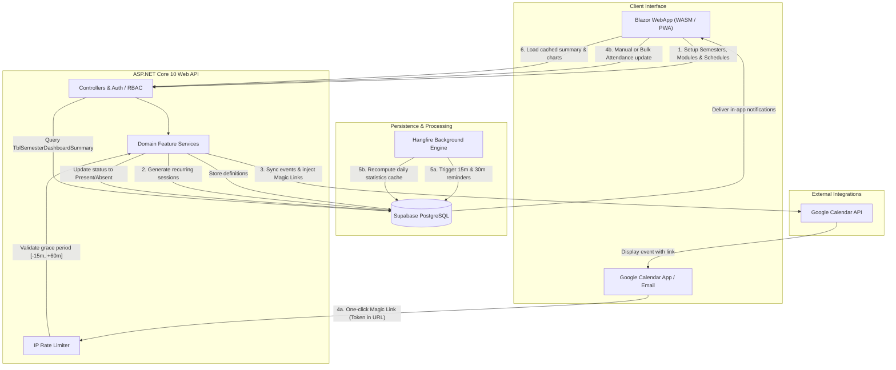

# Chronon: Personal Attendance & Class Schedule Tracker

[](https://dotnet.microsoft.com/)
[](https://supabase.com/)
[](https://dotnet.microsoft.com/en-us/apps/aspnet/web-apps/blazor)
[](https://www.hangfire.io/)
[](https://scalar.com/)

**Chronon** is a personal academic operations platform designed to organize class schedules, monitor attendance rates in real time, and streamline attendance logging through Google Calendar synchronization, time-window-validated passwordless magic links, and background automation.

---

## Motivation & Purpose

Academic guidelines commonly enforce strict attendance policies requiring students to maintain an attendance rate of **$\ge 75\%$** to qualify for final examinations.

Chronon addresses irregular class attendance and schedule complexity by providing:

1. **Real-time visibility**: Immediate insight into overall and per-module attendance performance.
2. **Early warning system**: Visual health indicators (Green / Yellow / Red alerts) to safeguard against falling below the critical 75% threshold.
3. **Frictionless logging**: Single-click **"Mark as Present" magic links** delivered directly into Google Calendar event descriptions, secured by cryptographic tokens and UTC time windows.
4. **Intelligent automation**: Automated recurrence generation, public holiday exclusion, and proactive background reminders.

---

## Project Architecture

Chronon follows a **Vertical Slice-like (Feature-based) Organization** to ensure high cohesion, low coupling, and clear separation of business domains.

```
Chronon-Attendance-Tracker/
├── ACST.Api/            # ASP.NET Core 10 Web API (Controllers, Auth, Middlewares, Rate Limiting, OpenAPI/Scalar)
├── ACST.Domain/         # Business Logic Feature Slices (Services, DTOs, Security Extensions)
├── ACST.Database/       # EF Core AppDbContext, Npgsql PostgreSQL Models (Tbl*), and db.sql schema
├── ACST.Shared/         # Shared helpers, Pagination models, and Result/Result<T> functional patterns
├── ACST.Domain.Tests/   # Unit test suite (xUnit) mirroring Domain feature slices
└── ACST.WebApp/         # Blazor WebAssembly client (TailwindCSS, PWA, Dark Mode, Interactive Dashboard)
```

### Architectural Principles

* **Direct Request-to-Persistence Pipeline**: Requests flow cleanly from API Controllers into domain service feature slices, persisting via Entity Framework Core (`AppDbContext`).
* **The Result Pattern**: Services encapsulate outcomes in strongly-typed `Result` or `Result<T>` containers rather than throwing control-flow exceptions.
* **Unified Timezone Handling**: All database records and server calculations operate strictly in **UTC**, formatted to the user's local timezone (Myanmar Time, UTC+06:30) at the UI representation layer.
* **Auditing & Soft Deletion**: Destructive actions employ soft deletion (`IsDeleted` / `DeleteFlag`) with automated query filters and cascading cleanup.

---

## Comprehensive Feature Modules

Chronon is organized into **11 core feature modules**, coordinating frontend views, backend APIs, and background workers:

```
┌─────────────────────────────────────────────────────────────────────────────────────────────┐
│                                       CHRONON DOMAIN                                        │
├──────────────────────────┬──────────────────────────┬───────────────────────────────────────┤
│ 1. Identity & RBAC       │ 2. Academic Structure    │ 3. Schedule & Attendance Engine       │
│  • Auth & Users          │  • Semesters             │  • Recurring Schedules                │
│  • Role & Permissions    │  • Modules (Courses)     │  • Class Sessions & Attendance Log    │
├──────────────────────────┼──────────────────────────┼───────────────────────────────────────┤
│ 4. Integrations & Sync   │ 5. Proactive Workers     │ 6. Intelligence & Search              │
│  • Google Calendar OAuth │  • Hangfire Reminders    │  • Real-Time Analytics & Dashboard    │
│  • Holidays Management   │  • System Health Checks  │  • Unified Cross-Entity Search        │
└──────────────────────────┴──────────────────────────┴───────────────────────────────────────┘
```

### 1. Authentication & User Management
* **JWT Token Lifecycles**: Issues cryptographically signed JWT access tokens and long-lived refresh tokens with automatic token rotation.
* **Security & IP Rate Limiting**: Built-in fixed-window rate limiters (`auth-policy`: 5 req/min) mitigate brute-force attempts on login and registration endpoints.
* **User Lifecycle**: Supports user registration, profile queries, and administrative soft deletion.

### 2. Role & Permission Management (RBAC)
* **Granular Matrix**: Dynamic mapping of system roles (`Admin`, `Student`, etc.) to functional permissions across all endpoints.
* **Administrative Bypass**: Built-in permission handlers allow users with the `Admin` role to bypass individual permission checks across all administrative actions.

### 3. Semester Management
* **Academic Boundaries**: Configures semester lifecycles with strict start and end dates.
* **Lecture End Date & Horizon Pruning**: Supports dedicated `lectureEndDate` boundaries; modifying this date automatically identifies and removes orphan sessions scheduled beyond class weeks.
* **Cascading Soft-Delete**: Deleting a semester safely soft-deletes nested modules, recurring schedules, and class sessions, while triggering background cleanup of synchronized calendar events.

### 4. Modules (Courses)
* **Course Cataloging**: Defines academic courses with unique module codes, descriptive names, assigned professors/lecturers, and UI color badges.
* **Integrity Validation**: Prevents duplicate module codes within active semesters and handles module-level soft deletions.

### 5. Recurring Schedules
* **Recurrence Engine**: Maps weekly course meeting rules (day of week, start time, end time) to academic modules.
* **Bounded Expansion**: Generates recurring sessions within the exact date boundaries of the host semester.
* **Cascade Rescheduling**: Adjusting or deleting recurrence rules synchronizes directly with affected future sessions.

### 6. Class Sessions & Attendance Tracking
* **Automated & Manual Session Creation**: Generates calendar-aware sessions based on recurrence rules or allows ad-hoc individual session creation.
* **5-State Attendance Tracking**: Tracks each class session as `Not Marked`, `Present`, `Absent`, `Cancelled`, or `Holiday`.
* **Frictionless Magic Links**: Issues unique UUID-based magic links for one-click attendance check-in without requiring active UI login.
* **UTC Grace-Period Validation**: Magic links are strictly validated against a dynamic grace period (**from 15 minutes before class until 1 hour after class**), preventing early or retroactive check-in tampering.
* **Bulk Attendance Operations**: Blazor UI supports multi-select bulk operations to mark, excuse, or cancel multiple sessions simultaneously with confirmation modal flows.

### 7. Google Calendar Integration
* **OAuth 2.0 Authorization**: Connects to the user's Google Calendar with secure token persistence and refresh handling.
* **Bi-Directional Event Synchronization**: Automatically creates Google Calendar events for generated class sessions and removes events upon session cancellation or semester deletion.
* **Magic Link Injection**: Injects the secure, passwordless "Mark as Present" check-in link directly into the Google Calendar event description for instant lock-screen or calendar notification check-in.

### 8. Holidays Management
* **Exception Handling**: Allows manual registration of academic and campus holidays.
* **Google Calendar Holiday Import**: Imports national and religious public holidays directly from Google Calendar feeds.
* **Automatic Session Tagging**: Class sessions matching holiday dates are automatically flagged as `Holiday` and excluded from the attendance calculation denominator.

### 9. Automated Notifications & Background Workers
* **Hangfire Scheduled Infrastructure**: Uses persistent PostgreSQL-backed Hangfire workers for autonomous system execution:
  * `upcoming-class-notifications` (Every 5 mins): Dispatches alerts 15 minutes prior to scheduled class start times.
  * `post-class-30min-reminders` (Every 5 mins): Reminds students to log attendance if a session ended 30 minutes ago and remains `Not Marked`.
  * `evening-attendance-reminder` (Daily at 18:30): Audits the day's completed classes and alerts the user of any unlogged sessions before day-end.
  * `daily-dashboard-update` (Daily at midnight): Recalculates and caches aggregate semester metrics in `TblSemesterDashboardSummary`.
  * `cleanup-old-notifications` (Daily at 02:00): Purges stale notification records older than retention policies.
* **In-App Notification Center**: Interactive notification bell in the Blazor header featuring real-time unread counts and read-state management.

### 10. Analytics & Health Dashboard
* **Dynamic Month Filtering**: Allows instantaneous filtering of statistics by overall semester or specific calendar months.
* **Cached Summary Engine**: Reads from `TblSemesterDashboardSummary` to eliminate expensive on-the-fly table aggregations during dashboard loads.
* **Visual Metric Indicators**: Real-time progress bars and status banners:
  * 🟢 **Green ($\ge 75\%$)**: Safe attendance standing.
  * 🟡 **Yellow ($60\% - 74\%$)**: Warning state — imminent risk of falling below examination threshold.
  * 🔴 **Red ($< 60\%$)**: Critical failure state — immediate remediation required.
* **Trend Visualizations**: Daily and weekly distribution charts, alongside per-module breakdown graphs with course code badges.

### 11. Global Search & System Diagnostics
* **Unified Multi-Entity Search**: Instantaneous search indexing across active Semesters, Modules, and Class Sessions.
* **System Health Probes**: Dedicated `/health` endpoint validating Supabase PostgreSQL connection pool readiness.
* **Interactive API Reference**: Built-in Scalar API Documentation (`/scalar/v1`) and Swagger UI (`/swagger`) available across all environments.
* **Worker Dashboard**: Embedded Hangfire dashboard (`/hangfire`) with administrative role protection.

---

## End-to-End Project Flow

The following sequence details how students, client applications, backend APIs, background workers, and external services interact across the complete system lifecycle.

### System Interaction Diagram



### The 4-Stage Lifecycle Workflow

```
[ Stage 1: Setup ] ──> [ Stage 2: Generation & Sync ] ──> [ Stage 3: Attendance Logging ] ──> [ Stage 4: Background & Analytics ]
```

#### Stage 1: Academic Configuration & Setup
1. **Authentication & RBAC**: The user authenticates; the system validates credentials and verifies role permissions via JWT.
2. **Academic Scaffolding**: The user defines an active semester with date ranges.
3. **Course & Schedule Mapping**: Academic modules are created and mapped to weekly recurring schedule slots (e.g., *CS101 on Mon & Wed 09:00 - 11:00*).
4. **Holiday Ingestion**: National or institutional holidays are imported from Google Calendar or defined manually.

#### Stage 2: Schedule Generation & Calendar Synchronization
1. **Materialization**: The schedule engine expands weekly recurrence rules across the semester timeline, generating individual `TblSession` records.
2. **Holiday Resolution**: The engine cross-references generated dates with holiday tables, automatically tagging intersecting sessions as `Holiday`.
3. **Calendar Synchronization**: If Google Calendar integration is connected, the API exports sessions to Google Calendar via batch requests.
4. **Token Generation**: A unique cryptographic `MagicLinkToken` is assigned to each session and embedded into the Google Calendar event description.

#### Stage 3: Daily Attendance Logging
1. **Option A: Single-Click Magic Link Check-in**:
   * The student opens their Google Calendar event or notification and clicks the injected magic link.
   * The API rate limiter validates the incoming IP request.
   * The server validates the session token and checks the current UTC timestamp against the allowable grace window:
     $$\text{Start Time} - 15 \text{ mins} \le \text{Current UTC Time} \le \text{End Time} + 60 \text{ mins}$$
   * If within the grace window, the session status updates to `Present` idempotently, and a responsive HTML confirmation view is returned.
2. **Option B: Blazor Dashboard Management**:
   * The student logs attendance directly in the web app, marking individual sessions or performing bulk updates across filtered lists.

#### Stage 4: Background Automation & Analytics Monitoring
1. **Proactive Reminders**:
   * Hangfire audits upcoming sessions every 5 minutes and pushes alerts 15 minutes before class.
   * Sessions ending without attendance after 30 minutes trigger follow-up reminders.
   * At 18:30 daily, an evening sweep alerts the student of any unresolved classes.
2. **Metrics Recalculation**:
   * Hangfire executes the daily summary worker at midnight, updating `TblSemesterDashboardSummary`.
3. **Visual Health Assessment**:
   * The Blazor dashboard renders real-time stats and monthly trend charts, warning the student with color-coded alerts if their attendance falls toward the 75% threshold.

---

## Attendance Calculation Formula

To guarantee that statistics reflect only actionable classes, cancelled classes and public holidays are excluded from the denominator. Furthermore, `Not Marked` (future or unrecorded) sessions are excluded from calculations until they are evaluated:

$$\text{Attendance Rate (\%)} = \frac{\text{Present Sessions}}{\text{Total Graded Sessions} - (\text{Holidays} + \text{Cancelled})} \times 100$$

### Indicator Thresholds

| Indicator | Attendance Rate | Status Definition | Recommended Action |
| :---: | :---: | :--- | :--- |
| 🟢 **Green** | **$\ge 75\%$** | Safe Standing | Attendance meets or exceeds university examination criteria. |
| 🟡 **Yellow** | **$60\% - 74.9\%$** | Warning Zone | High risk: missing additional sessions may result in academic penalties. |
| 🔴 **Red** | **$< 60\%$** | Critical Danger | Below permissible attendance limits; exam debarment imminent. |

---

